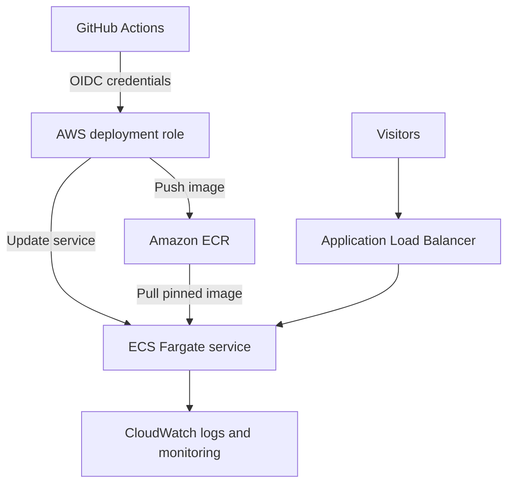

# Architecture overview

The paid kit targets one stateless Docker application. This is a conceptual overview, not a copy of its Terraform configuration.

Terraform manages the infrastructure. Release workflows build and publish the container image, update the ECS service, and verify the requested release. A rollback restores a prior application task definition; it does not reverse database migrations or external effects.

The sample uses one task by default, public subnets, and no NAT gateway. HTTPS requires the documented domain and certificate setup. AWS usage is billed to the customer's account; stopping a task alone does not remove every billable resource.
